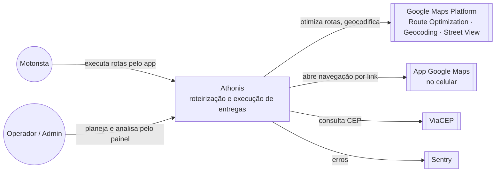
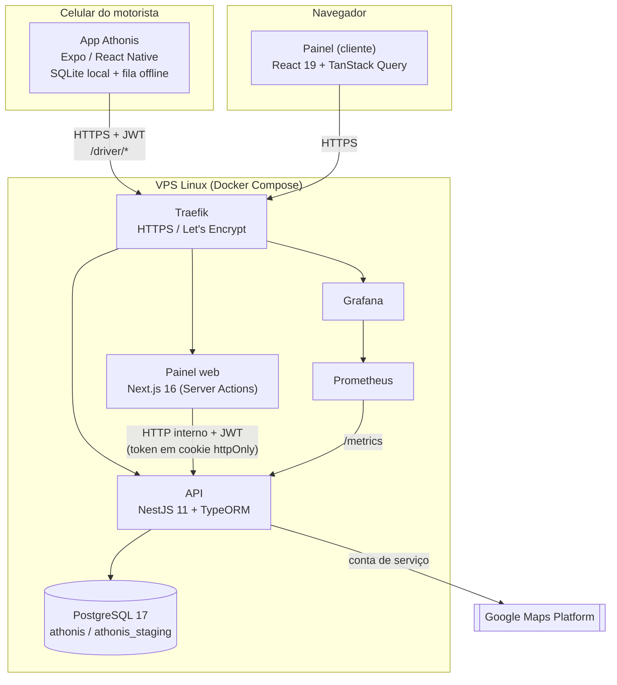
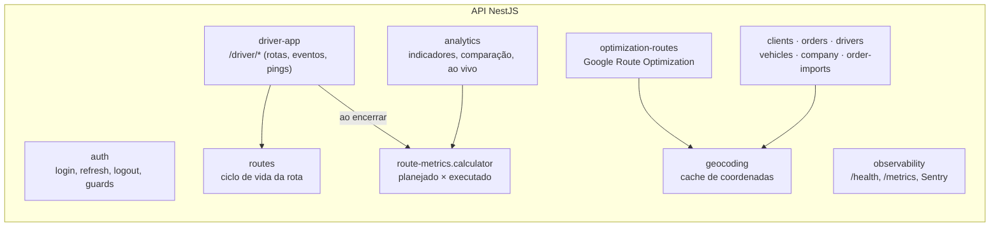
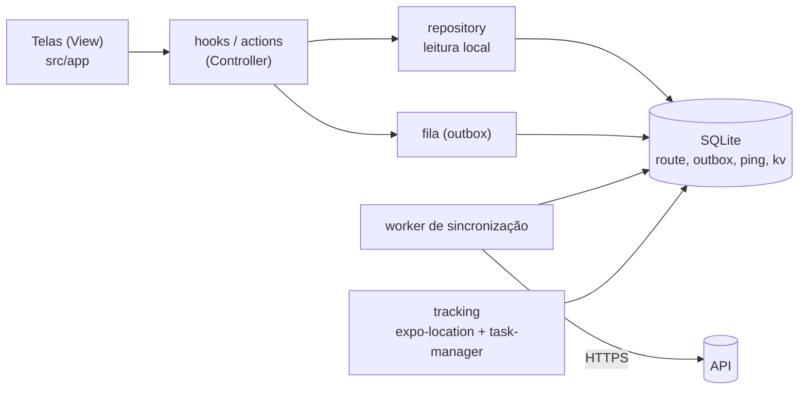

# Arquitetura (modelo C4)

## Nível 1 — Contexto

## Nível 2 — Contêineres

Produção e staging rodam lado a lado na mesma VPS (`api` / `api-staging`, `web` / `web-staging`), com bancos separados. Detalhes em [[Deploy e Infraestrutura|Deploy-e-Infraestrutura]].

## Nível 3 — Componentes da API

## Nível 3 — Componentes do aplicativo (MVC)

O artigo propõe MVC; no aplicativo o mapeamento é:

| Papel | Pasta | Conteúdo |
|---|---|---|
| **Model** | `src/features/*/model.ts` | Tipos e schemas Zod: Rota, Parada, Ocorrência, item da fila |
| **Controller** | `src/features/*/hooks.ts`, `actions.ts`, `src/services/*` | Chamadas à API, fila offline, sincronização, rastreamento, sessão |
| **View** | `src/app/**`, `src/components/**` | Telas e componentes de interface |

A tela **nunca** lê da rede: lê do banco local, que a sincronização mantém atualizado. Isso é o que permite o app funcionar sem sinal.
