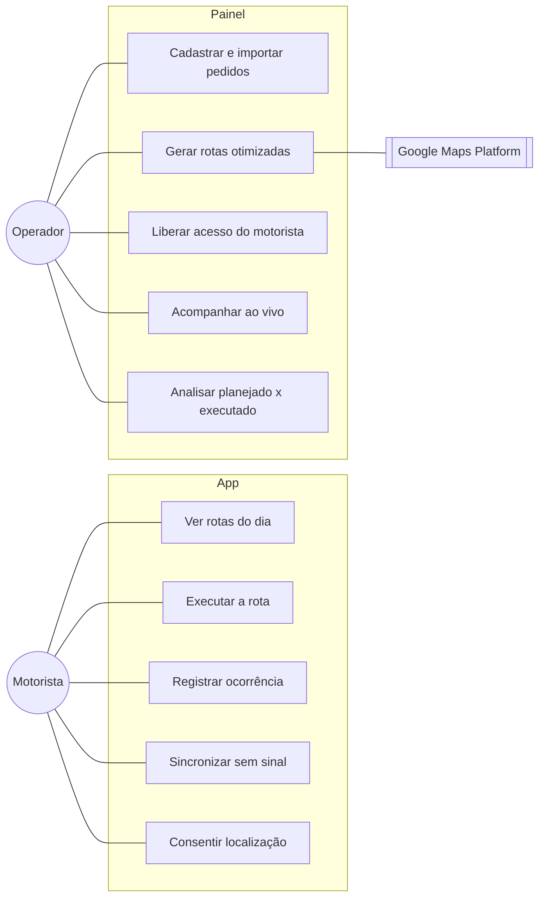

# Casos de uso

## Atores

| Ator | Quem é | Onde atua |
|---|---|---|
| **Motorista** | Entregador da empresa | Aplicativo |
| **Operador / Administrador** | Pessoa da logística que planeja e acompanha | Painel web |
| **Google Maps Platform** | Serviço externo | Otimização de rotas e geocodificação (chamado só pela API) |

## Histórias de usuário

- Como **motorista**, quero ver as entregas do dia na ordem certa, para não perder tempo decidindo o caminho.
- Como **motorista**, quero dar baixa mesmo sem sinal, para não depender da cobertura da operadora.
- Como **motorista**, quero informar por que não entreguei, para a empresa reagendar sem me ligar.
- Como **operador**, quero ver onde cada motorista está e qual a próxima parada, para responder ao cliente.
- Como **operador**, quero comparar a rota planejada com a executada, para ajustar o planejamento.
- Como **administrador**, quero criar e revogar o acesso de um motorista, para controlar quem usa o aplicativo.

---

## Fluxo 1 — Do pedido à rota no aplicativo

**Ator:** Operador. **Pré-condição:** empresa com depósito cadastrado, motorista com acesso ao aplicativo.

1. O operador cadastra os pedidos (ou importa uma planilha CSV); o endereço vem do cliente e o CEP preenche o resto.
2. Em **Rotas**, seleciona os pedidos do dia e pede **Gerar rotas**.
3. A API valida os pedidos (endereço geocodificado, capacidade), chama a Route Optimization do Google e grava uma `route` por veículo, com as paradas em ordem (`stop_sequence`) e o horário previsto.
4. O operador escala motorista e veículo (o painel avisa se a CNH não permite aquele veículo ou está vencida).
5. A rota aparece no aplicativo do motorista na próxima atualização.

**Alternativos:** pedido sem coordenada fica de fora, com o motivo; sem a API do Google, a rota é gerada em modo estimado (`simulated`), e o app avisa.

## Fluxo 2 — Executar a rota (com e sem sinal)

**Ator:** Motorista. **Pré-condição:** rota planejada para hoje.

1. O motorista abre a rota e toca **Iniciar rota**.
2. Na primeira vez, a tela de consentimento explica a coleta de localização; ele aceita ou recusa (recusar não impede a rota).
3. O rastreamento liga (notificação fixa no Android). A ação vai para a fila local e a tela muda na hora.
4. Em cada parada: **Navegar** (Google Maps) → **Cheguei** → **Entregue** (observação opcional).
5. Ao terminar, **Encerrar rota**: o resumo mostra entregues, ocorrências e duração; o rastreamento desliga.
6. A API consolida as métricas da rota (planejado × executado).

**Sem sinal:** os passos 3 a 5 funcionam igual; o selo no topo mostra "N pendentes". Quando a rede volta (ou o app volta ao primeiro plano), a fila sobe sozinha, em ordem e com a hora original. Ver [[Fila Offline|Fila-Offline]].

## Fluxo 3 — Não entrega (ocorrência)

**Ator:** Motorista.

1. Na parada, o motorista toca **Não entregue**.
2. Escolhe o tipo (cliente ausente, endereço não encontrado, recusado, mercadoria avariada, estabelecimento fechado, acesso restrito, trânsito ou outro) e escreve uma observação.
3. A parada fica como "Não entregue" e a próxima é destacada.
4. No painel, a rota mostra o motivo e a observação; a ocorrência entra no gráfico por tipo.

## Fluxo 4 — Analisar a execução

**Ator:** Operador.

1. Em **Análises → Execução em campo**, escolhe o período (7, 30 ou 90 dias).
2. Vê conclusão, pontualidade, atraso médio, ocorrências por tipo, desempenho por motorista e por região/horário.
3. Abre uma rota e vê a comparação parada a parada: sequência planejada × real, horário previsto × chegada, tempo de atendimento, e o trajeto real desenhado no mapa com as paradas ociosas.
