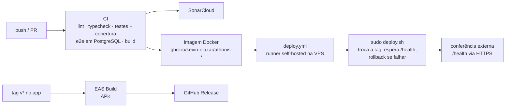

# Deploy e infraestrutura

Detalhes operacionais (comandos, arquivos, recuperação) ficam no [README da infraestrutura](https://github.com/kevin-elazar/AthonisBackend/blob/master/infra/README.md). Esta página resume.

## Onde roda

Uma **VPS Linux** (Hostinger KVM 2: 2 vCPU, 8 GB, Ubuntu 24.04), com **Docker Compose**. O servidor já tem o Coolify; o Athonis só se registra no proxy dele (Traefik) por *labels*, que emite os certificados Let's Encrypt. Por que VPS e não PaaS: [[ADR-06|Decisoes-de-Arquitetura]].

```text
Internet ──HTTPS──► Traefik (80/443, Let's Encrypt)
                      ├─ api.<domínio>          → api          ┐
                      ├─ staging-api.<domínio>  → api-staging  ├─► PostgreSQL 17
                      ├─ app.<domínio>          → web          │   (athonis / athonis_staging)
                      ├─ staging-app.<domínio>  → web-staging  ┘
                      └─ grafana.<domínio>      → Grafana ◄── Prometheus ◄── /metrics + node-exporter
```

| Ambiente | Endereço | Banco | Atualiza quando |
|---|---|---|---|
| Desenvolvimento | máquina local | `docker-compose.dev.yml` | — |
| Staging | `staging-api.` e `staging-app.<domínio>` | `athonis_staging` | CI verde na branch `desenvMobile` |
| Produção | `api.` e `app.<domínio>` | `athonis` | Release publicada (tag `v*`) |

## Pipeline



- **Sem SSH.** O runner abre a conexão de saída com o GitHub e busca o job; roda num usuário sem senha, fora do grupo `docker`, que só pode executar `infra/deploy.sh` com `sudo` ([[ADR-07|Decisoes-de-Arquitetura]]).
- **Segredos** (senha do banco, JWT, Grafana) são gerados no servidor pelo `vps-bootstrap.sh` e nunca saem dele. A chave da conta de serviço do Google é um arquivo montado só leitura, fora da imagem.
- **Backup:** `pg_dump` dos dois bancos às 03:00, 14 dias de retenção em `/var/backups/athonis`.
- **Imagens:** multi-stage, usuário sem privilégio e `HEALTHCHECK` (API em `/health`; painel em `/login`).

## Aplicativo

- `eas.json` tem os perfis `development` (APK com dev client, para testar GPS), `preview` (APK contra staging) e `production` (APK contra produção).
- Em tag `v*` no repositório do app, o CI dispara o EAS Build e anexa o APK a uma GitHub Release. É esse link que vai no QR Code do pôster.
- Distribuição por APK, sem loja (fora do escopo).

## Instalação do servidor do zero

Uma vez, como root, pelo terminal web da Hostinger:

```bash
curl -fsSL https://raw.githubusercontent.com/kevin-elazar/AthonisBackend/desenvMobile/infra/vps-bootstrap.sh -o /root/vps-bootstrap.sh
bash /root/vps-bootstrap.sh
```

O script instala Docker, clona o repositório em `/opt/athonis`, agenda o backup, detecta o proxy, gera os segredos, sobe banco e monitoramento e registra os runners do GitHub. A partir daí todo deploy vem do GitHub Actions.
