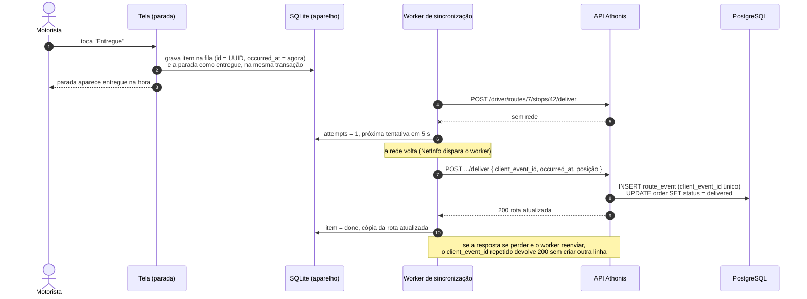

# Fila offline

Promessa do aplicativo: **nada do que o motorista registra se perde, chega duplicado ou chega fora de ordem**, com ou sem sinal. É a parte mais testada do app (`src/features/sync/__tests__/worker.test.ts`).

## Regras

1. **Escreve local primeiro.** A ação entra na fila (`outbox`) e a cópia da rota é atualizada na mesma transação; só depois o app tenta a rede. A tela lê sempre do banco local, então responde na hora.
2. **Ordem por rota.** Itens da mesma rota sobem um por vez, na ordem em que foram criados. Uma entrega nunca passa na frente do "iniciar rota" que a precede.
3. **Idempotência.** O `id` do item é o `client_event_id` (UUID gerado no aparelho), com índice único no servidor. Reenviar depois de uma queda de conexão responde com o resultado original, sem criar nada.
4. **Hora do aparelho.** `occurred_at` é capturado no toque, não no envio. O servidor guarda também quando recebeu.
5. **Nova tentativa com espera crescente.** Falha de rede, 408, 429 ou 5xx: espera 5 s, 15 s, 1 min, 5 min e depois a cada 15 min.
6. **Sessão expirada (401).** Renova o token (uma renovação por vez; as outras requisições aguardam) e repete.
7. **Recusa definitiva.** Outros 4xx (ex.: rota cancelada no escritório, 409): o item vira "recusado", com a mensagem do servidor, e libera os próximos. O motorista vê na tela de sincronização.
8. **Rastro em lotes.** Os pontos de GPS sobem em blocos de até 200, mais antigos primeiro, depois dos eventos de parada.
9. **Gatilhos.** Novo item na fila, rede voltou (NetInfo), app voltou ao primeiro plano, leitura de GPS (no máximo uma vez por minuto) e um intervalo periódico.
10. **Sair com pendências.** O logout avisa quantos itens não subiram e só apaga o banco local se o motorista confirmar.

## Sequência — baixa sem sinal

## Leitura sem sinal

A lista de rotas vem de `GET /driver/routes` e alimenta a cópia local. Sem rede, as telas abrem a última cópia e mostram quando ela foi atualizada. Uma atualização do servidor não sobrescreve paradas que ainda têm item pendente na fila: a fila é reaplicada por cima (`mergePending`).

## Como foi conferido

- Testes unitários com um servidor de mentira que falha como a rede real: ordem, idempotência, espera crescente, recusa definitiva, renovação de sessão e prioridade dos eventos sobre o rastro.
- Manualmente, com o backend desligado: três ações ficaram pendentes e subiram sozinhas quando ele voltou, em ordem e com a hora original.
