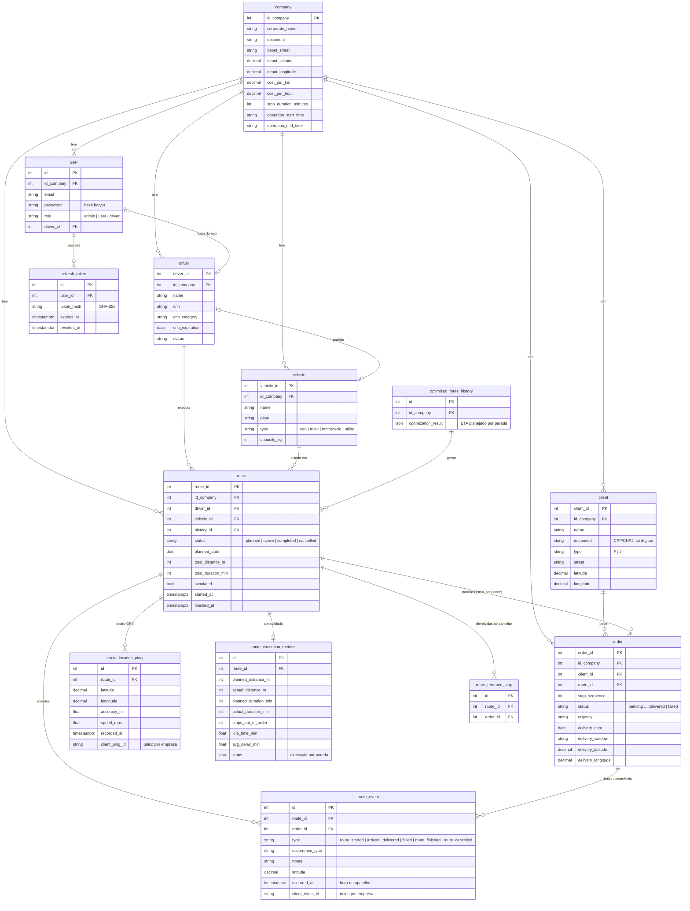

# Modelo de dados

PostgreSQL 17, esquema versionado por migrations do TypeORM (`AthonisBackend/src/database/migrations`). Toda tabela de negócio tem `id_company`: o isolamento entre empresas é feito pela API a partir do token.

## Banco local do aplicativo (SQLite)

| Tabela | Papel |
|---|---|
| `route` | Cópia das rotas do dia (JSON), para abrir sem rede |
| `outbox` | Ações a enviar, em ordem (`seq`): `id` = `client_event_id`, `kind`, `payload`, `status`, `attempts`, `next_attempt_at`, `last_error` |
| `ping` | Pontos de GPS ainda não enviados |
| `kv` | Valores avulsos (rota rastreada, dia da cópia, consentimento de localização) |

Os campos `client_event_id` / `client_ping_id` são UUIDs gerados no aparelho e têm índice único no servidor: reenviar não duplica (ver [[Fila Offline|Fila-Offline]]).
