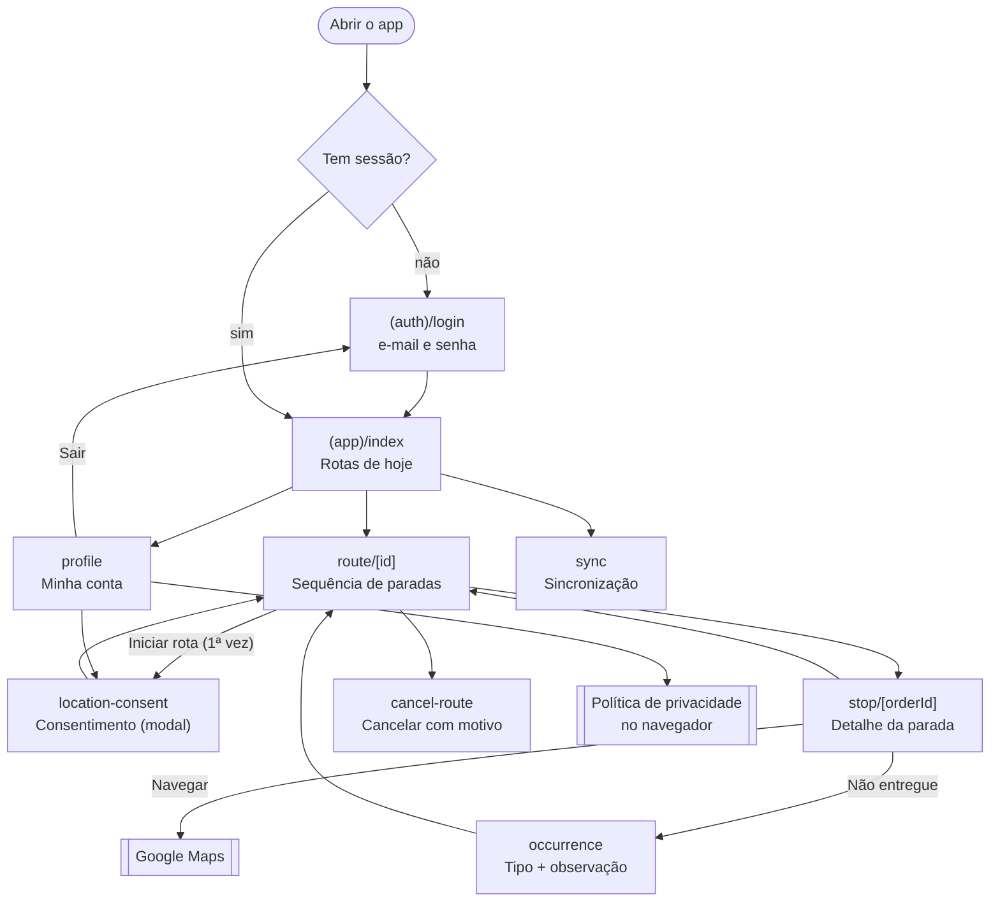

# Navegação do aplicativo

As telas são rotas do Expo Router em `src/app/`. O grupo `(auth)` só abre sem sessão; o grupo `(app)` só com sessão (a guarda fica em `src/app/_layout.tsx`).

| Tela | Arquivo | O que faz |
|---|---|---|
| Login | `(auth)/login.tsx` | Autentica e guarda o par de tokens no SecureStore |
| Rotas de hoje | `(app)/index.tsx` | Lista as rotas do dia (cópia local; atualiza ao puxar) |
| Rota | `(app)/route/[id].tsx` | Paradas em ordem, próxima destacada, iniciar/encerrar, resumo |
| Parada | `(app)/stop/[orderId].tsx` | Cliente, endereço, janela, nota; Navegar, Cheguei, Entregue, Não entregue, ligar |
| Ocorrência | `(app)/occurrence.tsx` | Tipo obrigatório e observação |
| Cancelar rota | `(app)/cancel-route.tsx` | Motivo do cancelamento; paradas abertas voltam ao planejamento |
| Sincronização | `(app)/sync.tsx` | Itens pendentes e recusados pelo servidor, com a mensagem |
| Minha conta | `(app)/profile.tsx` | Motorista, empresa, estado do rastreamento, privacidade, sair |
| Consentimento | `(app)/location-consent.tsx` | Explica a coleta antes do diálogo do sistema e grava a decisão |

O selo de sincronização ("Sincronizado" / "N pendentes") fica no cabeçalho de todas as telas do grupo `(app)`.
